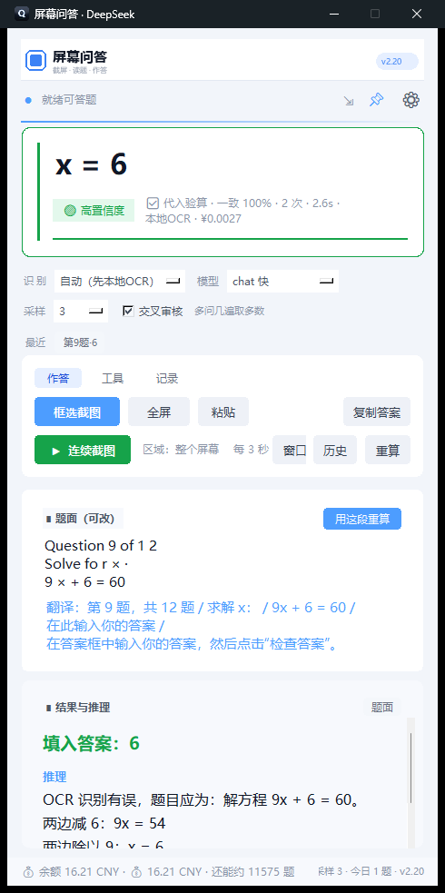
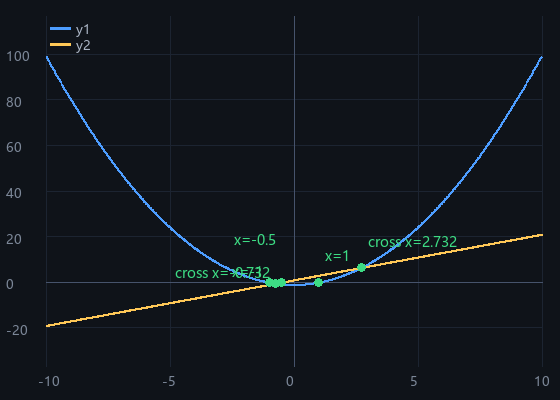
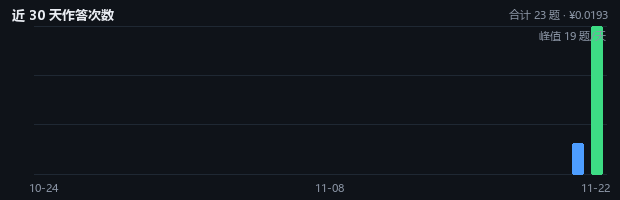
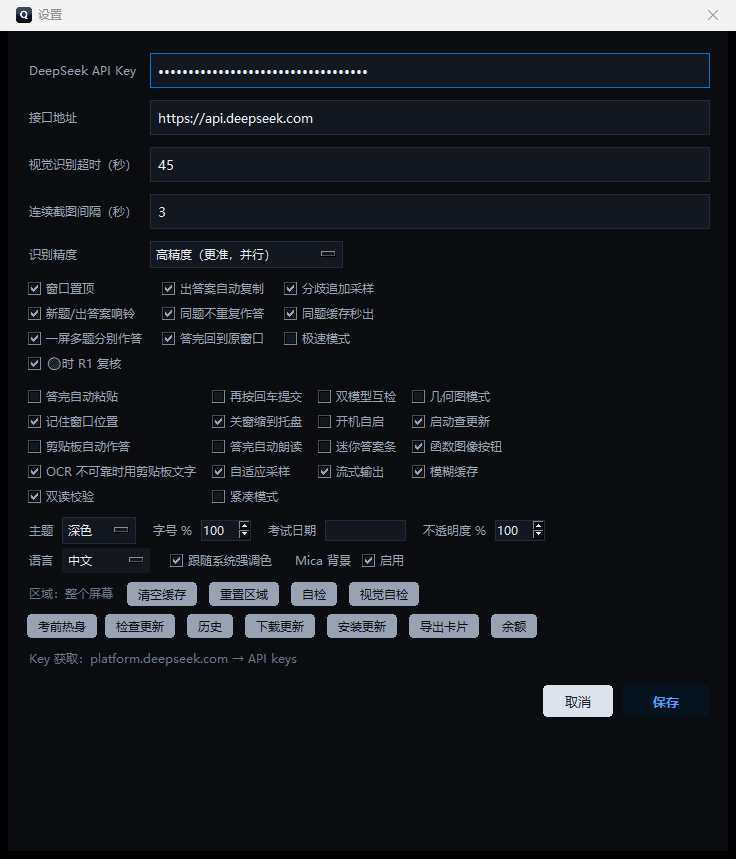
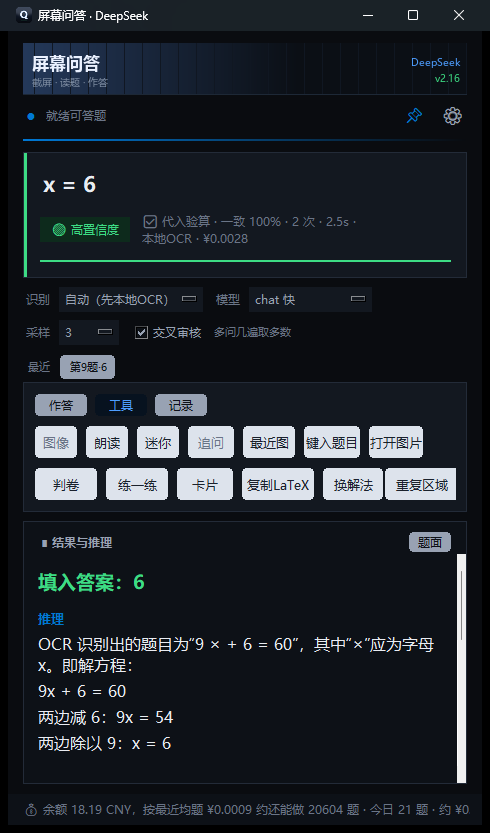
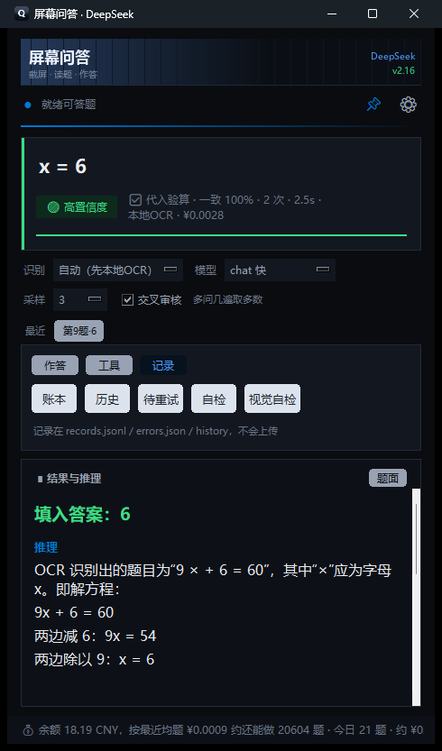
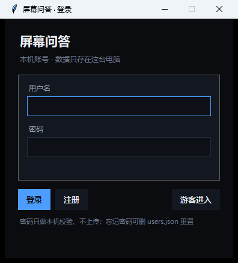
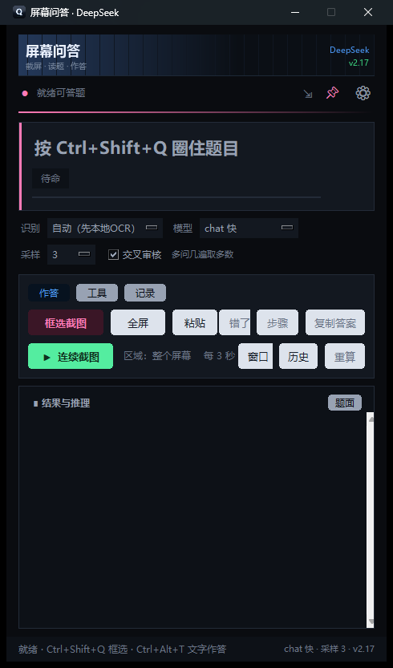
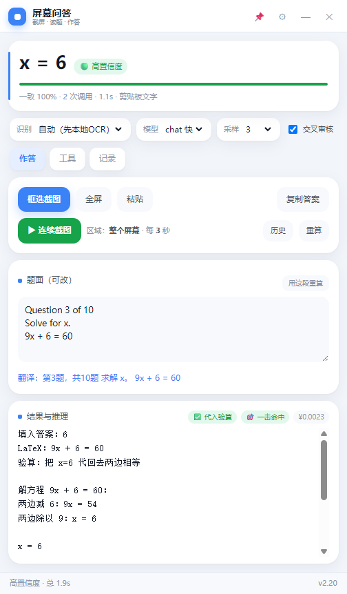

# 屏幕问答 · Screen QA

<p align="center">
  
</p>

> 圈一下屏幕上的题目，DeepSeek 自动读题、作答，并把答案自动复制到剪贴板。
> Windows 桌面小程序，Python + tkinter，无需安装 OCR 引擎（用系统自带 `Windows.Media.Ocr`）。
>
> 📖 **想看懂原理、准确度怎么来的、为什么做不到「≤1%」、考试怎么用** → [`docs/详解.md`](docs/详解.md)

## 它是什么

一个贴在屏幕右下角的小悬浮窗：

1. 按 `Ctrl+Alt+Q` 框选题目区域（或 `Ctrl+Alt+W` 整屏、或直接 `Ctrl+V` 粘贴截图）；
2. 程序用 **本地 OCR / 视觉模型** 把图片读成文字（DeepSeek 官方 API 不接受图片，所以先读字再思考）；
3. 把文字交给 **DeepSeek** 多次独立作答 → 多数投票 → 交叉审核 → 置信度分级；
4. 答案显示在大字号卡片里，并**自动复制**到剪贴板；
5. 打开「连续截图」后，程序每隔几秒抓一次指定区域，**画面没变化就不调模型**（省钱），出现新题自动作答。
6. 置信度只有 🟡/🔴 时，自动换 `deepseek-reasoner` **复核一遍**（R1 会慢 10–40 秒，但错题率明显下降；设置里可关）。

## 速度（本机实测，2560×1600）

| 情况 | 耗时 |
| --- | --- |
| 新题（框选 → 出答案） | 约 **4.1 秒**（本地 OCR 1.2s + 3 路并行作答 & 交叉审核 2.6s） |
| 做过的题（同题缓存） | 约 **1.2 秒** |
| 双击 启动.bat → 窗口出来 | 约 **2.2 秒** |
| 一屏 3 题分别作答 | 约 12 秒（每题都走完整投票+审核） |
| 重算（跳过缓存） | 约 3.6 秒 |
| 极速模式（1 次采样·不审核） | 约 **2.4 秒**（置信度自动降为 🟡，适合赶时间） |
| 🟡/🔴 触发 R1 复核 | 额外 **10–40 秒**（只在不确定时才用，🟢高不触发） |

> 3 路采样是**并行**发的（不是串行等三次），所以提速接近 2 倍，投票逻辑一点没变。
>
> 「自动」识别现在是**本地 OCR 优先**：OCR 质量够就直接用（0.5–1.2 秒），不再先傻等视觉模型；视觉超时也从 120 秒压到 45 秒。

## 界面

深色圆角卡片贴在右下角，答案一行大字号 + 左侧色条（绿=高 / 黄=中 / 红=存疑），
复制成功按钮会变成「已复制 ✓」，作答时状态栏有走点动画，最小化/被挡后会自动回到右下角。

### R1 复核真的会改判（本机实测）
故意让前 3 次采样投票出一个错答案（`x = 3`，一致度 67% → 🟡中），
程序自动触发 `deepseek-reasoner` 复核 → 它独立算出 **`x = 5`**（正确），
于是改判、采用新答案、并在详情里留痕：`R1 复核改判：x = 3 → x = 5`。
这条链路是真实 API 跑出来的，不是模拟。

## v2.8：OCR 不可靠时自动改用剪贴板文字

Windows 本地 OCR 对"整行只有符号/极短表达式"容忍度很低（回归 30 条里 3 条失败全是它：
`sqrt(2x+1)=5` 被读成 `sqrt()x + 1 ) = 5`、`(x^2-9)/(x-3)` 与 `C(5,2)` 整行消失）。v2.8 做了三件事：

1. **`.risk()` 判风险**：识别完后立刻判定 OCR 是否可疑 —— 空括号（系数被吞）、
   题面一个数字/符号都没有（整行被丢）、`sqrt(` 后面没有内容（根号空了）。
2. **自动换源**：可疑时读剪贴板文字；**只有数字有交集**（说明剪贴板和题面是同一道题）才替换，
   避免把上一次复制的东西当成这道题。替换处会在日志里明说：
   `OCR 不可靠（读到了空括号（系数可能被吞））→ 已改用剪贴板里的文字作答（29 字）`
3. **换成"文字作答"就没 OCR 了**：这一步等价于手动按 `Ctrl+Alt+T`，只是自动触发。

设置里新增勾选 **「OCR 不可靠时用剪贴板文字」**（默认开）。想关掉就关，回归测试不受影响。

实测（`cases/c02_radical.png`，剪贴板先放下正确题干）：

```
识别中（winocr → modlens）… 本地 OCR 够用（质量 49），跳过视觉模型
OCR 不可靠（读到了空括号（系数可能被吞））→ 已改用剪贴板里的文字作答（29 字）
【最终答案】x = 12      【填入答案】12      【代入验算】把 x=12 代回去两边相等
```

顺带修了验算的两个真 bug（同一轮发现）：
- `_ALLOWED` 原来只允许 `0-9x+-*/^().`，`sqrt(...)` 直接被判为非法 → 根号题永远 skip；
  现在允许白名单函数名（sqrt/sin/cos/tan/log/ln/exp/abs/pi），其它字母仍拒绝。
- `Solve for x. 9x + 6` 会把 `x.` 当成表达式的一部分 → 新增 `_drop_clause()` 先切掉指令前缀。

现在验算对 `sqrt(2x+1)=5` 也有效：`x = 12 → ok`、`x = 24 → fail（左边 7 ≠ 右边 5）`。

## 回归结果：30 条已知答案（2026-11-21，真实 API，关缓存）

```
正确 27/30 = 90% · 总耗时 124.4s · 平均 4.1s/题 · 69641 tokens · 约 ¥0.1393
其中受本地 OCR 限制：3 条（纯符号行整行丢失 / 系数被吞）
在能读到的题面上：27/27 = 100%
```

覆盖题型：一元/二次方程、分数系数、比例、根式、不等式、指数、对数、方程组、化简、
组合数、百分比、折扣、路程、平均数、增长率、函数值、斜率、负数解、分式方程、单题意选择题。

三条失败全部不是"模型算错"，而是 **Windows 本地 OCR 把整行丢掉了**：

| 用例 | 题面 | OCR 实际读到 | 结果 |
|---|---|---|---|
| `c02_radical` | `sqrt(2x + 1) = 5` | `sqrt()x + 1 ) = 5` | 系数 2 被吞 → 模型按 `sqrt(x+1)=5` 解出 24 |
| `c10_simplify` | `(x^2 - 9) / (x - 3)` | 整行消失 | 模型回"题目不完整" |
| `c18_comb` | `C(5, 2)` | 整行消失 | 模型回"缺少组合数" |

已实测确认：这不是分辨率问题（x2/x3 放大、锐化、加白边都试过，仍丢）。
Windows OCR 对"整行只有符号/极短表达式"的容忍度很低，只要前面有一个英文词就正常
（`Simplify: (x^2 - 9)/(x - 3)` 能读成 `Simplify: （ × ^ 2 一 9 ） / （ × 一 3 ）`）。

**应对（已内置）**：
1. 框选时**把上一行题干一起框进去**，别只框那个表达式；
2. 纯符号题用 `Ctrl+Alt+T` 从网页复制题干文字直接作答（完全绕过 OCR）；
3. 你在自己环境里若装了视觉模型（设置里「视觉自检」✅），这类整行丢失可能被视觉模型救回来 —— 本机沙箱里视觉不可用，所以这一层没测到。

`python tools/regress.py` 可随时复现上面这张表；`--fast` 看极速档、`--samples N` 改采样。

## v2.7：验算 / 花费 / 回归 / 追问 / 区域 / 中英（13 项）

| 能力 | 怎么用 | 说明 |
|---|---|---|
| 代入验算 | 自动（无需操作） | 填空题若是数值方程，把答案代回原式核对；答案卡显示 `✅ 代入验算` 或 `⚠ 代入验算不通过`，不通过会降置信度 |
| 花费与余额 | 设置里「余额」；启动时也会静默查一次 | 每题记录 `tokens_in/out` 与 `¥成本`，答案卡 meta 带 `¥0.0059` 这类数字；余额来自 `api.deepseek.com/user/balance` |
| 回归套件 | `python tools/regress.py`（可 `--fast` / `--limit N` / `--json`） | 8 条已知答案用例，逐题 ✅/❌ + 验算 + 耗时 + token + 正确率/均耗时/总花费 |
| 追问 | `Ctrl+Alt+F` | 再框一小块问"第二问/为什么"，单次调用，不走投票 |
| 数字核对 | 自动 | 上标被压平、答案数字没出现在推理里时给提示（不改编结论） |
| 前后一致性 | 自动 | 同一题号（`Question N of M`）前后答案不同时提醒 |
| Anki 卡片 | 设置 →「导出卡片」 | 错题本 → `错题卡片.txt`（TSV，可直接导入 Anki） |
| 多区域记忆 | 点「区域：…」标签 | 记住最多 5 个区域（题干区/答案框），一键切换；`重置区域` 清空 |
| 卡死看门狗 | 自动 | 单次作答超过 120 秒（`timeout_s`）在状态栏提示 |
| 中英文界面 | 设置 →「语言」 | 按钮/状态栏/弹窗走 `prompts.L`；推理内容仍是模型原文 |
| 跟随系统强调色 | 设置勾选「跟随系统强调色」 | 读 `HKCU\Software\Microsoft\Windows\DWM\AccentColor`，换成系统主色 |
| 下载更新 | 设置 →「下载更新」 | 从 GitHub 取最新源码包解到 `_update/`（只下载，不自动覆盖，避免动你在跑的版本） |
| 绿色版 zip | `python tools/make_portable_zip.py` | 把 `dist/屏幕问答` 压成 `dist/屏幕问答-绿色版.zip` |

## 视觉模型为什么可能用不了（以及怎么修）

详情框里出现

```
⚠ modlens 不可用（Error: Every configured vision provider failed for this image.
   codex-cli: spawn EPERM | claude-cli: spawn EPERM）
```

不是网络问题，而是**子进程没起来**。两个真实原因：

1. **npm 的 `codex` / `claude` 是 `.cmd` 批处理垫片**，Node 直接 `spawn` 一个 `.cmd` 在 Windows 上会被系统拒绝（`EINVAL`／`EPERM`）。
   修法：仓库里带了 `tools/cli_shims/codex.exe`、`claude.exe`（用 `csc.exe` 编译的极薄转发器），
   `启动.bat` 会把该目录**前置到 PATH**；程序运行时 `reader.ensure_shims()` 也会再兜一次。
   这样 modlens 先命中 `.EXE`，就能正常拉起 CLI。
2. **程序被限制型宿主拉起时**（例如被别的工具放进 Windows 作业对象／沙箱），
   子进程会被整体禁止 → 任何 CLI 都是 `EPERM`。这时只有你自己双击 `启动.bat`（脱离那个进程树）才正常。

**10 秒判断法**：⚙ → 点「视觉自检」。
✅ 说明视觉链路通了（会显示识别到的文字）；❌ 会给出真实错误和下一步建议。

兜底不变：视觉起不来时自动降级**本地 OCR**，文字类题目照样能做；
真正必须靠视觉的是**纯图形题**（几何图、函数图像、带图表的题）。

## 考试前 3 分钟自检

1. 右上角 ⚙ 里确认 Key 已填、模型 `deepseek-chat`；
2. 主窗「采样」选 **3**，「交叉审核」勾上（默认就是）；
3. 拿一道题按 `Ctrl+Alt+Q` 试一次，看到 `🟢 高` 和 `📋 已自动复制` 就放心；
4. 想更快就把采样调 1（约快一倍，但更依赖投票的防线就没了）；时间够就别调。

## 准确度是怎么提上去的（不是靠吹）

| 手段 | 作用 |
| --- | --- |
| 🟡/🔴 自动 R1 复核 | 多数投票打架时，换更强推理模型独立重解；它改判就采用新答案并标 🟡，两条链路一致才敢升 🟡 |
| 多次独立采样 + 多数投票 | 压掉模型偶发失误 |
| 分歧时自动追加 2 次采样 | 3 票不齐就再问 2 次，避免"2:1 侥幸通过" |
| 交叉审核（独立复核者角色） | 纠正"多数一致但都错"的系统性错误 |
| 高精度 OCR 多候选取优 | 原图 / 放大锐化 / 深色反色 / 低对比度二值化，按质量打分取最好 |
| 候选并行识别 | 多候选同时跑（各自独立进程），3 个候选从 1.4 秒降到 0.6 秒，白送速度 |
| OCR 误字自纠提示词 | 上标 ²、`sin`、标点被识别坏时由模型自行校正 |
| 置信度分级 | 🟢 高 / 🟡 中 / 🔴 存疑，不确定就直说，不假装确定 |

**必须说清楚**：没有任何程序能保证"错误率 ≤ 1%"。上面这些手段把错误率压到很低（同题三次采样一致 + 审核通过时最可靠），但模型本身、OCR、题目表述都可能出错。考试/重要场景请把它当"快速参考"，自己再核一遍。

## v2.6：新增的十项（更省手、更快、能复习）

| 能力 | 怎么用 | 说明 |
| --- | --- | --- |
| **剪贴板自动作答** | ⚙ 勾「剪贴板自动作答」 | 用 `Win+Shift+S` 截完图，程序 0.7 秒内自己发现并作答；不用再按热键。可在设置里写"只在某些窗口触发"（如 `mathlab,canvas`） |
| **纯文字直答** | `Ctrl+Alt+T` | 题目文字已在剪贴板（复制网页/PDF）时，跳过 OCR 直接问模型：**约 2.4 秒**、0 识别误差 |
| **迷你答案条** | `Ctrl+Alt+M` 或「迷你」按钮 | 一行答案、半透明、可拖到任意角落；双击复制，✕ 关闭。考试时窗口不挡题 |
| **按窗口截图** | 「窗口」按钮 → 选窗口 | 用 PrintWindow 抓**被遮挡也可**的窗口内容（下拉列出当前所有可见窗口） |
| **函数图像** | 题目含 `f(x)=…`/`y=…` 时点「图像」 | 纯 PIL 画坐标图并标出零点；不装 matplotlib |
| **朗读答案** | 「朗读」按钮 / ⚙ 勾「答完自动朗读」 | 走系统自带语音（中文 Huihui / 英文 Zira），不用装包 |
| **作业流水线** | 连续截图 + 题号判重 | 题号变了才作答；每题写进 `records.jsonl`，带题目截图 |
| **导出复习 PDF** | 历史 → 「导出 PDF」 | 每题一页：题目截图 + 答案 + 填入值 + 置信度；可直接打印复习 |
| **考试倒计时** | ⚙ 填「考试日期」(YYYY-MM-DD) | 启动时日志提示"还剩 N 天" |
| **自定义热键** | ⚙ 里改 `config.json` 的 `hotkey_*` | 被占用会自动换键，状态栏/日志显示**实际生效**的键 |

热键总表（默认）：`Ctrl+Alt+Q` 框选 · `Ctrl+Alt+W`/`Ctrl+Alt+S` 整屏 · `Ctrl+Alt+V` 剪贴板图 · `Ctrl+Alt+T` 纯文字 · `Ctrl+Alt+R` 重算 · `Ctrl+Alt+N` 下一题 · `Ctrl+Alt+M` 迷你条。

## v2.5：十项升级（作业/考试模式）

| # | 能力 | 怎么用 |
| --- | --- | --- |
| 1 | **答完自动粘贴** | ⚙ 勾「答完自动粘贴」→ 出答案后自动回到原窗口粘进输入框；想连回车一起提交再勾「再按回车提交」。默认关（粘贴目标可能是别的窗口）。 |
| 2 | **多题连答「下一题」** | 一屏多题时答案卡下方出现「下一题 ▶」；也可按 `Ctrl+Alt+N`（被占用会自动换键）。复制到剪贴板后你可直接 Ctrl+V。 |
| 3 | **一键复制步骤** | 按钮「步骤」→ 只复制推理过程（含题面），核对过程用。 |
| 4 | **双模型互检** | ⚙ 勾「双模型互检」→ 每次作答都额外让 `deepseek-reasoner` 独立解一遍：两条链一致才给 🟢，冲突会追加采样重投票，仍冲突就降为 🔴 存疑并提示人工核对。代价：每题多 10–30 秒。 |
| 5 | **几何图模式** | ⚙ 勾「几何图模式」→ 跳过"本地 OCR 够用就不看图"的短路，直接把整图交给视觉模型（坐标系、几何图形题用）。 |
| 6 | **错题本** | 按钮「错了」→ 记录到 `errors.json`；同一题（同 OCR 文本）下次出现会自动多问 2 路（最多 5 路）。 |
| 7 | **托盘 + 开机自启** | ⚙ 勾「关窗缩到托盘」→ 关窗口只隐藏，单击托盘图标显示/隐藏，右键菜单有「自检」「退出」；勾「开机自启」会写 HKCU…\Run（失败自动退到「启动」文件夹放 .bat）。⚠ 若系统/环境不允许加托盘图标，程序会明确提示"⚠ 托盘不可用 · 关窗口会退出程序"，不会变成关不掉的幽灵进程。 |
| 8 | **历史面板 + 导出 CSV** | ⚙ 或主窗「历史」→ 列表显示时间/题面/答案/填入值/置信度/耗时；可复制选中、导出 CSV（`records.jsonl` 是原始记录）。 |
| 9 | **主题 / 字号 / 透明度 / 位置记忆** | ⚙ 里「主题：深色/浅色」「字号 80–160%」「不透明度 60–100%」；勾「记住窗口位置」后下次按上次坐标打开（默认仍贴右下角）。主题/字号改动重开窗口生效。 |
| 10 | **启动查更新** | ⚙ 勾「启动查更新」→ 启动 2.6 秒后问 GitHub，若远端有新提交就在状态栏提示；也可随时点「检查更新」。 |

新增热键：`Ctrl+Alt+N` 下一题 · `Ctrl+Alt+V` 剪贴板图作答 · `Ctrl+Alt+R` 重算。

新增文件：`extras.py`（托盘/自启/更新检查）、`records.jsonl`（作答记录）、`errors.json`（错题本）。

## 打包成 exe（免安装）

```
python tools/build_exe.py
```

产物：`dist\屏幕问答\屏幕问答.exe`（旁边是 `_internal\`，整个文件夹一起拷走即可，约 44 MB）。
已经放好的一份：`C:\Users\MI\Desktop\屏幕问答\程序\屏幕问答.exe`，双击即用，**不需要装 Python**。

- 为什么默认是"文件夹 + exe"而不是单文件：启动快（实测 2 秒级）、不用往 `%TEMP%` 解压（某些受限环境解压会报 `Failed to create parent directory structure`）、杀软误报少。
- 想要单文件可以 `python tools/build_exe.py --onefile`，代价是每次启动要解压约 1–2 秒。
- exe 版会把 `psocr.ps1`、`assets\`、`tools\cli_shims\` 在首次运行时自解到 exe 旁边（配置文件也在旁边，删了会重建默认值）。

## 桌面版（最快上手）

把 `screen-qa` 整个文件夹放到桌面（例如 `C:\Users\MI\Desktop\屏幕问答`），双击里面的 **`启动.bat`**：

- 约 **2 秒**出现右下角小窗（实测 2.22s）；
- 万一启动失败会**弹窗**告诉你原因，并写 `_startup_error.log`，不会再"点了没反应"；
- 也可以在桌面建快捷方式，目标指向 `启动.bat`，图标选 `assets\app.ico`。

## 安装

### 方式一：给 DeepSeek Harness（DSH）当技能装

```bash
npx -y skills add qiancheng19494/screen-qa --skill screen-qa --global
```

装完在 DSH 里就能用 `screen-qa` 技能（技能里写了完整调用步骤）。

### 方式二：直接跑（推荐给普通用户）

需要 Python 3.10+ 和 Pillow：

```bash
git clone https://github.com/qiancheng19494/screen-qa.git
cd screen-qa
pip install -r requirements.txt
python app.py
```

Windows 用户也可以克隆后直接双击 `启动.bat`（无控制台窗口）。

### 识别顺序（为什么不再等半天）

「自动」= **先本地 OCR**（0.5–1.2 秒）：质量分 ≥ 45 且字数 ≥ 25 就直接用，**不叫视觉模型**；
只有 OCR 明显不行（乱码、字太少、几何图）才去拉起视觉模型，且视觉超时压到 **45 秒**（原来 120 秒，一等就是几分钟）。

## 使用

| 操作 | 说明 |
| --- | --- |
| `Ctrl+Alt+Q` | 框选屏幕区域识别（拖框，Enter 整屏，Esc 取消） |
| `Ctrl+Alt+W` | 直接识别整个屏幕 |
| `Ctrl+V` | 粘贴剪贴板里的图片 |
| ▶ 连续截图 | 自动盯住一块区域，新题自动作答 |
| 📋 已自动复制 | 出答案即进剪贴板（可在设置里关） |
| 🔔 响铃 | 发现新题「叮咚」两声、答案好了「叮」一声、出错「嘟嘟」（设置里可关） |
| 同题不重复作答 | 连续模式下题目没变（只有光标/计时器在动）不会重复调用模型 |
| ⚡ 同题缓存 | 同一道题第二次遇到直接秒出（约 1.3 秒），不再调模型 |
| 一屏多题 | 截图里有多道编号题时，切开逐题作答，每题单独给「复制」按钮 |
| 填空答案 | MyMathLab / Canvas 这种有输入框的题，会额外给「填入答案」= 能原样粘进去的值（自动复制的就是它） |
| 答完回到原窗口 | 框选完答出来，焦点自动还给你刚才那个页面，直接 `Ctrl+V` 就行 |
| 重算 | 置信度 🟡/🔴 或你觉得不对劲时，按「重算」重跑一次（跳过缓存、重新多路投票） |
| 多个空 | 一题两个以上输入框时，每个空一个复制按钮（`空1·2`、`空2·3`），逐个复制 |
| 极速模式 | 设置里勾选：只问 1 次、不做交叉审核，约 2.4 秒；置信度会自动降为 🟡（因为没复核） |
| 答案自动清洗 | 复制前把 `x = 5` 洗成 `5`、全角 `２，３` 洗成 `2, 3`、去掉 `$` 和句末句点，粘进 answer box 就是对的格式 |
| 框歪了会提醒 | 只识别到不到 12 个字时直接提示重框，**不会再拿垃圾文字去问模型**（省钱省时间） |
| 第 N/M 题 | 状态栏会显示 `第 9/12 题`；连续模式靠题号判断"换题了没有"，比纯文字比对准 |
| 最近答案 | 答案卡下面一排 `最近`：留最近 6 条（题号+答案），点一下重新复制，不用翻回原题 |
| OCR 修正层 | 把 Windows OCR 认错的形近字/符号改回来再喂模型（`阝 in`→`sin`、`x—O)`→`x→0)`、`标亻介`→`标价`、`3X2 一 33X`→`3X2-33X`） |

### 考试 / 作业流程（MyMathLab、Canvas 一小题一作答）

1. 在浏览器里打开题目，别把窗口盖住题目；
2. 按 `Ctrl+Alt+Q`，框住**这一小题**（题干 + 输入框都框进去更稳）；
3. 等卡片出答案（新题约 4–6 秒，做过的题约 1.3 秒），答案里 `填入：` 那个值已经自动复制；
4. 焦点已经回到浏览器 → 直接 `Ctrl+V` → `Enter`。

> 一小题一作答时**别开连续截图**，手动框选更快也更准（连续模式适合一屏好几题、慢慢做的作业）。
> MyMathLab 的 answer box 只认值本身（比如 `3`、`3/5`、`$64`），所以程序优先复制「填入答案」；
> 如果它没给填入值，复制的就是完整答案（`x = 3` 这种），粘进去前自己看一眼要不要去掉 `x =`。

首次使用点右上角 ⚙ 填 **DeepSeek API Key**（[platform.deepseek.com](https://platform.deepseek.com) → API keys），也可以设环境变量 `DEEPSEEK_API_KEY`。

每次作答都会在 `history/` 下存一份 Markdown（题目原文 + 推理 + 答案），方便回看。

## 设置项

- **识别精度**：高精度（多候选并行识别，比标准档只慢约 0.2 秒）／标准（最快）
- **采样次数**：1（省钱）/ 2 / 3（默认）/ 5（最稳）
- **交叉审核**：让模型换个角色复核答案
- **分歧时追加采样**：票数不齐时自动多问 2 次
- **新题/出答案响铃**：听觉提示，连续模式盯题时不用一直看窗口
- **同题不重复作答**：连续模式下同一道题只解一次
- **同题缓存秒出**：默认开；同一题第二次出现直接复用结论（`cache.json`，可一键清空）
- **重算**：主窗按钮；🟡/🔴 时点一下，跳过缓存重新投票
- **极速模式**：设置里勾选，只问 1 次不审核（2.4 秒），置信度自动标 🟡
- **OCR 修正层（`ocrfix.py`）**：只改"敢确定"的错——全角数字/括号/斜杠、`氵去`→法、`亻介`→价、数字之间的"一"→`-`、`阝/卩 + in`→`sin`。
  **故意不猜**：`刈`→`x`、`3X2`→`3x²`。理由：我试过 `刈`→`x`，它把 `sin` 的碎片变成 `x`，反而把一道本来答对的题（B. 3/5）带成 B. 3——
  所以这条规则被删了。修不了的交还给模型判断，比猜错强。
- **一屏多题分别作答**：默认开；检测到编号题就切开逐题解
- **答完回到原窗口**：默认开；框选作答后把焦点还给浏览器
- **出答案自动复制**：默认开
- **连续截图间隔**：默认 3 秒
- **模型**：`deepseek-chat`（默认，快）/ `deepseek-reasoner`（推理强，慢）

## 文件说明

| 文件 | 作用 |
| --- | --- |
| `app.py` | 界面 + 主流程（`--cli` / `--image FILE` 无界面模式） |
| `capture.py` | 截图、DPI 适配、框选遮罩 |
| `psocr.py` + `psocr.ps1` | 调系统 OCR（`Windows.Media.Ocr`），含多候选增强 |
| `reader.py` | 识别层：视觉模型（可选 modlens）→ 本地 OCR 自动降级 |
| `solver.py` | 多采样 + 投票 + 追加采样 + 交叉审核 + 置信度 |
| `deepseek_api.py` | DeepSeek HTTP 客户端（纯标准库 urllib） |
| `config.py` | 配置读写与历史存档 |
| `hotkey.py` | 全局热键（RegisterHotKey） |
| `questions.py` | 一屏多题切分 + 题号解析（`Question 9 of 12` → `第 9/12 题`） |
| `tools/launch_detached.py` | 从终端/脚本里把界面拉到后台启动（不占控制台） |
| `tools/push_via_api.py` | 本机 git push 不通时，用 GitHub API 提交代码 |
| `docs/详解.md` | **完整文本解释**：数据流、代码地图、准确度机制与实测、速度账本、考试流程、故障处置、隐私 |

## 一次框选背后发生了什么（速览）

```
Ctrl+Alt+Q 框选 → 截图
   → 读字：视觉模型（可选）失败则降级 Windows.Media.Ocr
          high 档并行跑「原图 / 放大锐化 / 深浅反色(+低对比度二值化)」三候选，按分数取最优
   → 分题：按题号切（切不动就整段当一题）
   → 作答：3 路并行独立采样 → 多数投票 → 分歧再追 2 路 → 交叉审核 → 置信度 🟢/🟡/🔴
   → 清洗：x = 5 → 5 ；２，３ → 2, 3 ；去掉 $ 和句末句点
   → 落地：答案卡 + 自动复制 + 焦点还原 + history/ + cache.json
```

细节与实测数字见 [`docs/详解.md`](docs/详解.md)。

## 可选：接视觉大模型

装了 [`modlens`](https://github.com/liustack/modlens) 并把 `reader_order` 设为 `["modlens","winocr"]`，程序会先用视觉模型整图理解（公式、表格更准），失败自动降级到本地 OCR，降级原因会显示在日志里。

## 隐私

- 截图和识别文字都在本机处理，只有**识别出的文字**会发给 DeepSeek API 作答；
- API Key 只存在本地 `config.json`（已加入 `.gitignore`），不会上传；
- `history/` 里的记录也只在本机。

## License

MIT

## 两个"考试现场才发现"的细节（v2.1）

**1. 答案格式要求会被自动满足。** Pearson 的题经常写「Round your answer to two decimal places」「Simplify your answer」「Enter as a percent」「Enter both answers, smaller first」——
程序会把这句话抠出来（`questions.format_hint`），一边塞进提示词，一边在出答案后按它改写入框值：

| 题目要求 | 模型给的 | 自动改成 |
| --- | --- | --- |
| Round to two decimal places（7x=22） | 3.142857 | `3.14` |
| Simplify, write as a fraction（8/12） | 0.666… / 8/12 | `2/3` |
| Write 0.25 as a percent | 0.25 | `25%` |
| smaller first（两个解） | 3, 1 | `1, 3` |

同时投票也按"洗过之后的答案"比对——同一道题写成 `3.14` 和 `3.142857` 不再算两票，
所以置信度反而更准（实测那道题从 🔴存疑 60%/6 次调用 变成 🟢高 100%/4 次调用）。

**2. 热键被占用会自动换键，并把真实生效的键显示出来。**
本机 `Ctrl+Alt+W` 就被别的软件占着，程序会自动退到 `Ctrl+Alt+S`，状态栏直接写明
`就绪 · 按 Ctrl+Alt+Q 圈题 · 整屏 Ctrl+Alt+S · 重算 Ctrl+Alt+R`——不让用户按一个没反应的键。
新增 `Ctrl+Alt+R` = 重算上一次（答案看着不对，手不用离开网页）。

## v2.9：一键重试 / 稳定性回归 / 考前热身

| 能力 | 怎么用 | 说明 |
|---|---|---|
| **一键重试** | 失败后点「重试」或按 `Ctrl+Alt+R` | 失败时最右边那颗按钮会自动从「重算」变成「重试」：不用重新框，用同一张图/同一段文字再跑一次。成功后又变回「重算」（跳过缓存重算） |
| **稳定性回归** | `python tools/regress.py --repeat 3` | 每条用例跑 3 次，输出 `x/3` 与「稳定性：N/M 条 3 次全对」，把"偶尔对"和"稳定对"区分开 |
| **考前热身** | ⚙ 设置 →「考前热身」 | 11 秒左右跑完：Key 格式 → 余额 → 本地 OCR → 视觉模型 → 8 个热键实际键位 → 两张真实题图各答一遍，最后给结论（可以开始 / 部分通过 / 有硬性问题） |

热键多了一个用途：`Ctrl+Alt+R` 在失败时是「重试」，成功时是「跳过缓存重算」——同一颗键，失败就点它。

## 回归结果：稳定性（2026-11-22，`--repeat 3`）

见下方"稳定性"小节实际输出；`--repeat` 比单跑更能暴露 temperature 带来的抖动。

## v2.10：更快、更省、更能抓出错读

| 能力 | 默认 | 效果 |
|---|---|---|
| **自适应采样** | 开 | 先问 1 次，答案能代回原式验算通过就不再问 → 简单题 4.0s → **1.8s 左右**，调用从 4 次降到 2 次 |
| **流式输出** | 开 | 边生成边把推理滚到详情框（总耗时不变，等待感更轻） |
| **模糊缓存** | 开 | 缓存键从"整段文本 sha1"改成"题号+数字集合"做签名，题面差一个句点/空格也能命中 |
| **双读交叉校验** | 开 | 视觉模型可用时，OCR 与视觉各读一遍，相似度 <55% 就在提示里列出两版原文，明确告诉你"题面可能被读错" |
| **超时降级** | 自动 | 某一题超过 `timeout_s`（默认 120s）→ 下一题自动先走单次采样，不再让你干等 |
| **数字键 1–9** | — | 多题时按数字键复制第 N 题的答案 |
| **紧凑模式** | 关 | 小屏（1366×768）用，窗口矮 87px、详情框 5 行 |
| **安装更新** | 设置里 | 下载后点「安装更新」把 `_update/` 覆盖到程序目录（保留 config.json / history / 缓存） |
| **自建回归用例** | — | `python tools/add_case.py --image 我的题.png --answer "x = 6"` 一条命令加进 30 条回归集 |

自适应采样为什么敢省：`verify.py` 会把答案代回原式核对（不依赖模型的自我评估）。验算通过才省，验算不通过/无法验算（选择题、证明题）仍然问满 3 次。

新开关都在 ⚙ 设置第二组勾选里，可单独关掉。

> **双读交叉校验默认关闭**：视觉模型要拉起 CLI，你机器上首次可能要几十秒；考试时每题多等 45 秒不值得。想用它核对自己有没有读错题面时，在 ⚙ 里打开「双读校验」。

## v2.12：判卷 / 练习 / 卡片 / 重复区域 / 自动裁边

| 能力 | 怎么用 | 说明 |
|---|---|---|
| **判卷** | 做完题点「判卷」，填你自己写的答案 | 模型把参考答案和你写的答案一起核对，输出「判定 / 原因 / 正确做法」；错的会指出代进去算差多少 |
| **练一练** | 点「练一练」 | 拿当前题当模板生成 3 道同类型题（含答案），存到 `练习/` |
| **导出卡片** | 点「卡片」 | 一题一张 PNG（题干缩略图 + 答案 + 置信度 + 耗时），存到 `cards/` |
| **重复上次区域** | `Ctrl+Alt+Shift+Q` | 用上次框选的区域直接再截一次，不用手动画框 |
| **自动裁边** | 自动 | 框选/整屏图先裁掉四周纯色留白再做 OCR，少给 OCR 喂无关像素 |
| **预算提醒** | 自动 | 今日花费超过 `budget_day`（默认 1.0 元）时状态栏变黄一次，不每题都吵 |
| **失败重试** | 自动 | 单个样本偶发 429/超时，会等 0.9 秒重试一次再算失败 |

新增开关在 `config.json`：`"autocrop": true`、`"budget_day": 1.0`、`"hotkey_repeat": "ctrl+alt+shift+q"`。

## v2.13 / v2.14：读题更稳、答案更规范、操作更少

| 能力 | 作用 | 说明 |
|---|---|---|
| **键入题目** | 直接敲/粘贴题面作答，完全不用截图 | 面板「键入题目」，Ctrl+Enter 提交；考试时最稳的一条路 |
| **打开图片** | 从文件系统选一张题图 | 替代"拖拽"（见下方说明） |
| **复制 LaTeX** | 把题干转成 LaTeX 并复制 | Mathpix 式输出，粘到 Canvas/Word/Overleaf 直接排版 |
| **换解法** | 同一个答案换一种方法再讲一遍 | 先写「方法：…」再给步骤，末行核对同一答案 |
| **待重试队列** | 失败的题自动入队，点击可重跑 | 断网/超时不用重新框选 |
| **Key 加密（DPAPI）** | `config.json` 里不再存明文 Key | 只有本机当前用户能解密 |
| **不等式验算** | `x > 3` 这类答案也会代回检查 | 扫变号点 + 二分定边界，方向/分界点都核对 |
| **选择题选项代入** | 不再一律 skip | 把 A–D 选项代入题干，唯一成立才算通过 |
| **多函数图像** | `y=x^2-1 and y=2x+1` 画在同一张图 | 显示零点与交点（交点标 `cross x=…`） |
| **离线回归** | 改代码后 0 元验证判定逻辑 | `python tools/make_snapshot.py` 存快照，`python tools/regress_offline.py` 回放 |
| **exe 自动替换** | 「安装更新」在打包版里可自动替换并重启 | 走 `_apply_update.bat`：等进程退出 → 覆盖 → 重启 |
| **迷你条贴光标** | 迷你答案条出现在鼠标附近 | 不再固定屏幕角落 |

**关于"拖拽图片"**：Tk 原生不支持文件拖放，需要在装 `tkinterdnd2` 这类第三方库；本项目坚持"零额外依赖"，所以用 **打开图片…** / **Ctrl+Alt+V 粘贴截图** / **最近图** 三条路替代，效果等价、少一个依赖。

**离线回归怎么用**（改完代码先跑这个，0 元）：
```bash
python tools/make_snapshot.py --limit 8   # 存快照（会花少量费用，一次就够）
python tools/regress_offline.py           # 回放：只验判定与验算逻辑
```

---

## 界面一览（v2.15）

| 作答结果 | 多函数绘图 |
|---|---|
|  |  |

| 30 天账本 | 设置面板 |
|---|---|
|  |  |

## 术语对照（本项目 vs 常见叫法）

| 本项目用词 | 高校/平台叫法 | 含义 |
|---|---|---|
| 框选 | snip / capture region | 圈出一块屏幕区域并截图 |
| 题面 | problem statement / 题干 | 从图里读出来的题目原文 |
| 填入答案 | answer box value | 能直接敲进 MyMathLab 输入框的字符串 |
| 一致度 | agreement | 多次采样里投给同一答案的比例 |
| 代入验算 | substitution check | 把答案代回原式核对（本地算，不花钱） |
| 双模型互检 | dual-model cross-check | `chat` 投票 + `reasoner` 独立求解对照 |
| 抽样 | sample | 一次独立的模型作答（3 抽样 = 问 3 遍取多数） |
| 待重试队列 | retry queue | 失败/断网的题排队，稍后一键重跑 |
| 绿/黄/红 | confidence tier | 高置信度 / 需核对 / 存疑 |

## 致谢

- 交互思路参考了朋友的 [SpellCardHomework / 符卡作业簿](https://github.com/Jerry9335/SpellCardHomework)（MIT）：LaTeX→符号渲染、英文题翻译、"摘录可改→改完重算"的三段式、用量账本、启动横幅。我们按其思路重写实现，未复用其代码与素材。
- **没有**照搬它的 CDP 全自动网页答题与一机一码授权：前者涉及"代交作业"边界且要引入 websocket 依赖，后者与 MIT 免费发布冲突。

### v2.16：三页分区（作答 / 工具 / 记录）

| 作答页 | 工具页 | 记录页 |
|---|---|---|
|  |  |  |

- 一页只显示一组按钮，窗口高度从 983 降到 **833**，详情区更宽裕；
- 答案卡底部徽章：`🎯 一击命中`（自适应单次通过）、`✅ 代入验算`、`🤝 双模型一致`、`⚡ 缓存`、`¥0.0025`；
- 待机时答案卡显示轮换提示（"小问：框一下题目，我来算。"）；
- 顶栏横幅自绘（`tools/make_banner.py`），右侧显示当前版本。

### v2.17：本机账号 + 自由窗口 + 主题色 + 多服务商

| 登录窗 | 樱花主题 | 自由窗口 |
|---|---|---|
|  |  | 设置 →「窗口：自由窗口」后可拖动缩放 |

- **本机账号**：注册 / 登录 / 游客进入；密码 PBKDF2-SHA256（12 万次迭代 + 随机盐）只存本机 `users.json`，**不上传**。登录后数据在 `data/<用户名>/`（配置、作答记录、错题本、缓存、历史各自独立）；游客沿用程序根目录（旧数据照旧）。
- **自由窗口**：设置里切「窗口：自由窗口」，标题栏右侧图标可在"贴右下角 ↔ 自由"之间切换；自由模式可拖动、可拉伸，位置尺寸会记住。
- **主题色**：青蓝 / 樱花 / 薄荷 / 浅金；`跟随系统强调色` 仅在主题色为"自动"时生效。
- **多服务商**：设置里下拉选 DeepSeek / OpenAI / 智谱 GLM / 通义千问 / OpenRouter / Ollama 本地，自动填写接口地址；模型名在主页下拉里选（OpenAI 兼容协议即可用）。
- 状态栏余额压缩为 `💰 18.19 CNY · 还能约 20604 题`，不再挤满一行；页切换加了 3 帧微动效。

## 云端模式（可选）：把 Key 和记录放到你自己的服务器

```text
你电脑上的桌面端                你的服务器（1C1G 就够）            DeepSeek
┌──────────────────┐   HTTPS   ┌────────────────────────┐       ┌───────────┐
│ 截图 → 本地 OCR   │ ────────► │ /api/proxy/chat/...     │ ────► │ 官方 API   │
│ Solver（投票/验算）│           │ 账号登录 / 令牌 / 配额   │       └───────────┘
│ 答案卡 / 剪贴板    │ ◄──────── │ /api/sync（记录同步）    │
└──────────────────┘           │ /（网页版：粘贴或传图）   │
                               └────────────────────────┘
```

- **截图永远在本机**：服务器看不到你的屏幕，只接收文字。
- **客户端不需要 DeepSeek Key**：Key 只存在服务器的环境变量里；桌面端拿的是这台的登录令牌。
- **云端关了也能用**：设置里点「关闭代理」立刻回到本机 Key 直连。
- 服务器代码在 [`server/`](server/)，纯标准库（`http.server` + `sqlite3`），`server/deploy.md` 是部署步骤（Docker / systemd / HTTPS / 配额 / 安检要点）。

桌面端入口：⚙ → 「云端」→ 填地址 → 登录/注册 → 开启代理；「同步记录」把 `records.jsonl` 增量推到云端。
命令行：`python tools/sync_cloud.py --since 0`。

## v2.21：WebView 界面（C 方案落地）

界面从 Tk 换成了 **HTML/CSS/JS + WebView2**，逻辑仍然是同一套 Python（识别 → 验算 → 投票 → 缓存）。



**怎么跑**

```bash
pip install pywebview          # 只需要这一个额外依赖
python app_web.py              # 或双击 启动-WEB版.bat
```

Tk 版仍然保留（`python app.py` / `启动.bat`），WebView 出问题随时切回去。

**结构**

| 层 | 文件 | 职责 |
|---|---|---|
| 界面 | `ui/index.html` `ui/app.css` `ui/app.js` | 布局、主题、交互，纯前端 |
| 桥 | `webui_bridge.py` | 把 `run_pipeline` / 截图 / 剪贴板 / 账本暴露成 JS 可调方法 |
| 宿主 | `app_web.py` | 无边框 WebView2 窗口 + 全局热键 + 窗口定位 |

**这版能看到的改变**

- 真正的 CSS 圆角、阴影、渐变、悬停动效（Tk 做不到的）
- 26px 粗体答案 + 一致度进度条 + 徽章（✅ 代入验算 / 🎯 一击命中 / ¥0.0023）
- 题面卡可编辑，改完点「用这段重算」；英文题自动附中文翻译
- 设置抽屉：Key / 接口 / 主题 / 强调色 / 字号 / 自动粘贴 / 双模型互检 / 自适应采样

**已知限制**

- WebView 版暂不支持窗口不透明度（WebView2 后端的 `opacity` 会抛 `ZoomFactor` 异常，已捕获跳过）
- 还没打成 exe（Tk 版仍是 exe 分发；WebView 版需要 Python + pywebview）
- 连续截图、判卷、练一练、账本目前先在 Tk 版用，WebView 版正在补齐
